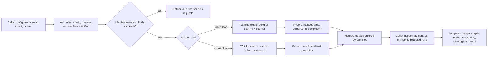
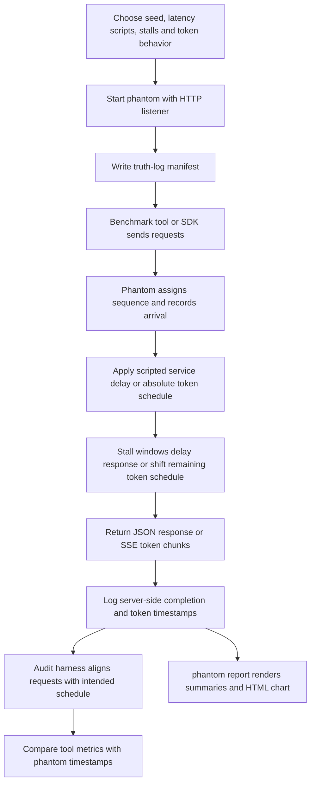

# Tailbench project guide

This guide explains the problem Tailbench tackles, the parts of the repository, and how a request becomes a measurement or an audit result. It is based on the implementation and the project documentation. It is intended for readers who are new to the codebase.

## What problem does this project solve?

Latency benchmarks can report a number that looks precise while measuring the wrong thing. A common pattern sends one request, waits for its response, then sends the next. This is a **closed-loop** workload. If a server freezes, the benchmark client freezes with it. It sends no requests during the freeze, and therefore omits the requests users would have made during that time. This bias is called coordinated omission. In the repository's 500 ms freeze example, the closed-loop p99 is about 1 ms while the open-loop p99 is about 401 ms.

Tailbench is a Rust library for running scheduled requests and examining their latency. Its emphasis is measurement quality: it records the intended send time as well as actual send and completion times, writes information about the build and machine before the first request, and compares repeated runs with rules that can report “inconclusive” or refuse an invalid comparison.

The workspace also contains **phantom**, a scripted OpenAI-compatible test server. Phantom can produce known response delays, token schedules, and freezes, while logging its own timestamps. This gives benchmark authors a reference point for checking what a client or another load-testing tool actually measures.

### Goals, impact, and use cases

- **Avoid hiding overload and freezes.** Open-loop scheduling continues to send requests at the intended rate even while earlier requests are unfinished. Latency is measured from intended send time, so queueing and delayed sends remain visible.
- **Separate target delay from generator delay.** For each open-loop request, Tailbench records scheduler lag (`actual send − intended send`) and service time (`completion − actual send`). Their sum is the measured latency.
- **Make results traceable.** The JSON manifest records build and runtime Git information when available, machine and toolchain details, runner settings, and caller-supplied labels. Unknown facts are marked `UNKNOWN` instead of guessed.
- **Avoid overstating A/B conclusions.** Statistical comparisons use multiple runs, check whether runs are comparable, account for uncertainty, and can refuse a conclusion when data support is weak. A split comparison can examine normal request latency and slow episodes separately.
- **Audit benchmark tools and client behavior.** Phantom's known schedule and ground-truth log make it possible to compare a tool's output with server-side timestamps. The freeze-drill example also shows what an application using the OpenAI Python SDK experiences under provider freezes.

Likely users include engineers benchmarking inference services, maintainers validating a load generator, and teams comparing server changes across repeated runs. Tailbench is currently a library: callers provide an async request closure. There is no Tailbench CLI or built-in HTTP target yet.

### Measurement workflow



In open loop, each request runs in its own task and in-flight work is not capped. This preserves the schedule but means a non-responding target can cause in-flight tasks to accumulate. Closed loop has at most one request in flight; it is useful for that workload shape, but its latency starts at actual send and can hide time that the client spent waiting to send.

## Project structure

```text
tailbench/
├── Cargo.toml, Cargo.lock, build.rs       # Rust workspace and build provenance
├── src/                                    # Tailbench library
├── tests/                                  # Tailbench integration tests
├── phantom/
│   ├── Cargo.toml                          # phantom binary/package
│   ├── src/                                # scripted server, CLI, report and demo
│   ├── tests/                              # server, CLI, report and audit tests
│   └── docs/                               # endpoint, truth-log and audit references
├── examples/
│   ├── freeze-drill/                       # SDK-facing freeze demonstration
│   └── real-server-freeze/                 # real server/tool comparison experiment
└── docs/calibration.md                     # statistical calibration results
```

The main dependency direction is simple: the Tailbench library produces samples and manifests; `compare` consumes repeated `RunResult` values paired with manifests; phantom provides a controllable HTTP server and truth logs for tests and tool audits. Phantom does not call Tailbench internally as a production dependency; the audit tests connect the two as harnesses.

## Main code, file by file

### Tailbench library (`src/`)

- **`src/lib.rs`** defines the public library surface: `RunConfig`, `RunnerKind`, `RunResult`, `Sample`, and the `run`, `open_loop`, and `closed_loop` entry points. It schedules requests, records HdrHistograms and raw per-request samples, and checks that a manifest is written and flushed before sending anything. Open-loop latency is completion minus intended send; closed-loop latency is completion minus actual send. Histograms use microseconds and record clamping counts, while raw samples preserve nanoseconds.
- **`src/manifest.rs`** collects the provenance record. It probes build and runtime Git state, OS and architecture, kernel, CPU, Rust version, build profile, Tokio runtime details, clock state, schedule parameters, and extra labels. A `Probe` serializes unavailable values as `"UNKNOWN"`; build and runtime commit IDs are compared to flag a binary built from a different checkout.
- **`src/git.rs`** contains the Git subprocess rules shared by `build.rs` and the manifest code. It ignores inherited `GIT_*` repository overrides, avoids optional locks, validates full SHA names, and only trusts Git state when the crate directory is the repository root. This prevents a vendored Tailbench copy from accidentally recording its parent project's commit.
- **`src/episodes.rs`** splits one run into a normal “body” and slow episodes. It derives a shared threshold (default: ten times the pooled median, or a caller-set absolute threshold), finds consecutive slow samples, expands them into time windows, and removes all requests sent inside those windows from the body. Removing the full window matters because requests sent near the end of a freeze may finish quickly but were still affected by it.
- **`src/stats.rs`** implements the statistical building blocks: nearest-rank percentiles, tail-support checks, block and hierarchical bootstrap confidence intervals, Welch intervals, Student-t calculations, exact binomial tests, and the deterministic SplitMix64 random generator. These helpers let Tailbench preserve time dependence within a run and evaluate episode counts without relying on a general-purpose statistics dependency.
- **`src/compare.rs`** defines recorded runs, comparison options, warnings, verdicts, and formatting. It checks compatibility (including runner kind), warns when environments or offered load differ, then estimates a percentile change using either the default per-run Welch method or hierarchical bootstrap. It only calls a change faster/slower when the confidence interval, minimum effect, run count, and tail support allow it. `compare_split` separately compares body p99 and episode rate, with guards against drawing a direction from too few episodes.
- **`src/synth.rs`** creates clock-free synthetic `RunResult`-like samples for calibration. It models a lognormal latency body with optional between-run offsets and autocorrelation, plus optional single or Poisson-distributed stalls. Independent random streams keep the baseline body stable when a stall is added.
- **`src/calibration.rs`** runs repeated synthetic experiments over selected autocorrelation, run variability, stall, sample-size, and effect-size settings. It measures false directional verdicts and power for comparison methods, formats the results as Markdown, and can update `docs/calibration.md` when the calibration test is run with its opt-in environment variable. It is compiled for tests, not normal library use.

### Phantom server and tools (`phantom/src/`)

- **`phantom/src/lib.rs`** is the server core and its public API. It parses and validates scripted fixed or lognormal service times, TTFT and ITL schedules, output-token settings, and non-overlapping stall windows. `Script` deterministically derives timings from seed and request sequence. `start` serves health endpoints and OpenAI-style chat/completions endpoints, including server-sent-event streams; it writes a manifest and one ground-truth JSONL record per completed or abandoned request. Stream logs include scheduled and actual token handoff times and stall waits.
- **`phantom/src/main.rs`** defines the `phantom` command-line interface. It validates CLI specifications, starts the Tokio runtime/server, installs shutdown handling, and routes `report` and `demo` subcommands. Its terminal panel redraws the live monitor and handles terminal-width detection and ANSI color output.
- **`phantom/src/live.rs`** implements the in-memory live monitor and its text rendering. It groups arrivals into 100 ms buckets, tracks per-bucket latency distributions and stall counts, calculates rolling p99 signals and a live freeze verdict, and formats a width-aware terminal panel with bars and sparklines. It is presentation and monitoring support; the JSONL truth log remains the durable request-level record.
- **`phantom/src/report.rs`** reads phantom JSONL logs and turns them into a human-readable report plus optional HTML chart. It parses the requested rate, infers run boundaries from arrival gaps, reconstructs intended open-loop send times, computes nearest-rank percentiles and per-run summaries, and renders escaped HTML/SVG with request and stream timing details. Its logic accounts for multiple runs in one log and incomplete final lines.
- **`phantom/src/demo.rs`** runs a self-contained comparison between a naive closed-loop client and a scheduled open-loop client against phantom. It warms connections, pools/reuses TCP connections, sends requests around a scripted freeze, computes p99 outcomes, and prints a compact demonstration of coordinated omission.

### Build and package files

- **`build.rs`** captures values that must describe the binary at compile time: rustc version, Cargo profile and optimization level, Git commit, and whether build-relevant source paths were dirty. It sets compile-time environment values for the manifest. Probe failures do not fail compilation; they become `UNKNOWN`.
- **`Cargo.toml`** defines the root `tailbench` crate and the workspace membership of `phantom`, along with dependencies and package metadata. **`phantom/Cargo.toml`** defines the standalone phantom package/binary and its HTTP, CLI, async, and serialization dependencies. **`Cargo.lock`** and **`examples/real-server-freeze/driver/Cargo.lock`** pin dependency resolution for their respective workspaces. **`rustfmt.toml`** sets formatting preferences.

## Phantom audit workflow



Phantom's timestamps are ground truth for when requests arrive and when response data is handed to the server's response stream. That is a useful reference, but a lower bound on client-observed latency: it does not include all response writing, transport, or client reading time. The documented audits use loopback on one machine, fixed scripted workloads, and one tested machine, so they demonstrate methodology rather than broad real-network performance.

## Tests and what they protect

These tests are executable code too; the descriptions below explain their purpose rather than list each assertion.

### Tailbench tests (`tests/`)

- **`tests/stall.rs`** runs a fake server under paused Tokio time and demonstrates the closed-loop/open-loop difference during a freeze. It also checks intended sample ordering, histogram percentiles, confidence intervals, and body/episode splitting.
- **`tests/manifest.rs`** checks the recorded runtime/build fields, deterministic extra-field ordering, the guarantee that manifest output precedes the first request, and that a failed manifest write sends nothing.
- **`tests/realtime.rs`** measures scheduler lag on the real clock using both single-thread and multi-thread Tokio runtimes. It prints measurements to make timer resolution visible; unlike paused-clock tests, exact timing depends on the host.
- **`tests/compare.rs`** builds seeded fake runs and checks directional and inconclusive outcomes, one-off versus repeated stalls, environment warnings, runner mismatch refusals, split body/episode results, and an optional slower calibration-style false-verdict experiment.

### Phantom tests (`phantom/tests/`)

- **`phantom/tests/spec.rs`** validates accepted and rejected timing, lognormal, and stall syntax, overlap rules, and the behavior of a constructed script.
- **`phantom/tests/server.rs`** checks ordinary HTTP responses, deterministic fixed/lognormal service timing, stall delays, dense request sequence numbers, manifest/log shape, health routes, and periodic flushing.
- **`phantom/tests/stream.rs`** checks streaming chat and completions responses: SSE framing, token counts and text, TTFT/ITL schedules, role chunks, usage/final chunks, deterministic timing, stall schedule shifts, and request-option validation.
- **`phantom/tests/abandon.rs`** closes clients mid-request or mid-stream and verifies abandoned-request records, partial-token counts, and sequence continuity.
- **`phantom/tests/cli.rs`** invokes the binary with invalid scripts and verifies that bad arguments are refused with useful errors.
- **`phantom/tests/report.rs`** exercises the report command, its percentile/chart output, HTML writing, and invalid input handling.
- **`phantom/tests/runs.rs`** checks run-boundary inference, mismatched offered-rate warnings, and reading a JSONL file while its last record is incomplete.
- **`phantom/tests/demo.rs`** verifies the demo's key teaching point: the naive client reports a much smaller p99 for a freeze than the scheduled client.
- **`phantom/tests/common/mod.rs`** supplies shared audit fixtures: it launches phantom and Tailbench, derives intended-time truth from logs, reads streaming schedules, and implements reference percentile conventions used by external-tool audits.
- **`phantom/tests/audit.rs`** contains timing-sensitive Tailbench-versus-phantom control and stall audits for both runner modes. These are ignored by default because each uses a real-clock multi-second run.
- **`phantom/tests/audit_oha.rs`** runs the external `oha` tool with several connection and latency-correction settings, then compares its JSON output and percentile indexing with phantom truth. External runs are ignored by default.
- **`phantom/tests/audit_guidellm.rs`** runs GuideLLM against streaming phantom scenarios and examines TTFT, end-to-end, ITL, scheduled latency, and role-chunk behavior. Tests that need the external binary are ignored by default; parser/reference tests run locally.
- **`phantom/tests/audit_vllm.rs`** runs vLLM's benchmark client under constant, Poisson, closed-loop, and concurrency-limited scenarios, then compares TTFT/E2E/ITL and queue time with phantom truth. External runs are ignored by default.

## Examples

- **`examples/freeze-drill/drill.py`** starts a fresh phantom for each scenario and calls it through the official OpenAI Python SDK with three timeout configurations. It records what the application observed (first token, received tokens, completion, timeout/exception) alongside phantom's request and token log, then builds a drill card and HTML report. **`examples/freeze-drill/README.md`** gives setup and usage instructions; `drill.html`, `drill.json`, and `requirements.txt` are generated/output or dependency files rather than source logic.
- **`examples/real-server-freeze/run.py`** orchestrates an experiment against a real server: checks the endpoint, collects versions, runs several benchmark clients around a process freeze, captures logs/results, and parses each tool's output. **`examples/real-server-freeze/driver/src/main.rs`** is a small Rust open-loop driver; it timestamps each scheduled request with wall-clock origin metadata and emits request samples and summary percentiles. **`expected.py`** simulates expected latency for unlimited-concurrency and single-FIFO clients around a freeze, including phase averaging when the exact schedule origin is uncertain. **`build_results.py`** combines captured experiment outputs into the checked-in result data; **`chart.py`** turns results into chart data/rendering inputs. `calibration.json`, `results.json`, and `chart.html` are experiment inputs/outputs, while `driver/Cargo.toml` and its lockfile define the helper binary's package.
- **`phantom/docs/examples/report-c1.html`** is a checked-in rendered report example, not executable application logic.

## How to read the results and their limits

The repository demonstrates several different questions that should not be collapsed into one “latency” number:

1. **What delay did the benchmark's schedule experience?** Tailbench's open-loop latency starts at the intended send time; scheduler lag and service time reveal where the delay accrued.
2. **What delay did the server itself observe?** Phantom logs handler arrival and handoff timestamps. These are useful ground-truth reference points but omit part of the client-side path.
3. **What does a repeated comparison support?** `compare` estimates a change across runs with an uncertainty interval. The default method is per-run Welch because the checked-in synthetic calibration found the hierarchical bootstrap too prone to false verdicts under between-run variability at small run counts.
4. **Are rare stalls obscuring ordinary performance?** `compare_split` separates body p99 from the rate of threshold-defined episodes. The split depends on a threshold and the body can be biased; a naturally slow mode above the threshold will be treated as episodes.

Important practical boundaries from the project's own documentation:

- The external-tool audits measure loopback on one machine, not a real network, and use scripted synthetic responses.
- Tokio timers have roughly millisecond granularity on the tested setup; scheduler lag can materially affect small differences. Tailbench's default minimum named effect is 1 ms for this reason.
- Open-loop work is unbounded in flight. Choose count and interval with the target and client resource budget in mind.
- Calibration is synthetic and does not prove the same false-verdict rate for real services. The real-server-freeze example is a separate experiment, not a general cross-platform guarantee.
- Percentile definitions, queue-time accounting, and the meaning of “ITL” differ among benchmark tools. The audit reports record these definitions because similarly named metrics may not be directly comparable.

For runnable commands, current findings, full manifest and log schemas, endpoint details, and calibration tables, see the [README](../README.md), [phantom documentation](../phantom/README.md), and [calibration report](calibration.md).
